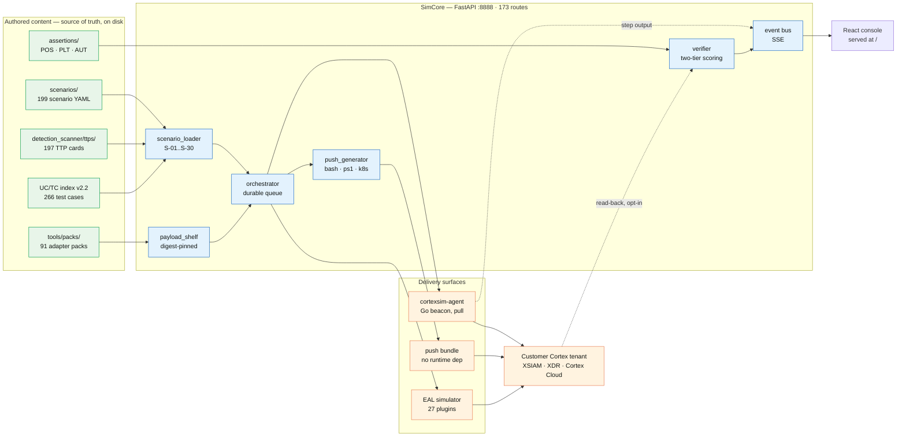
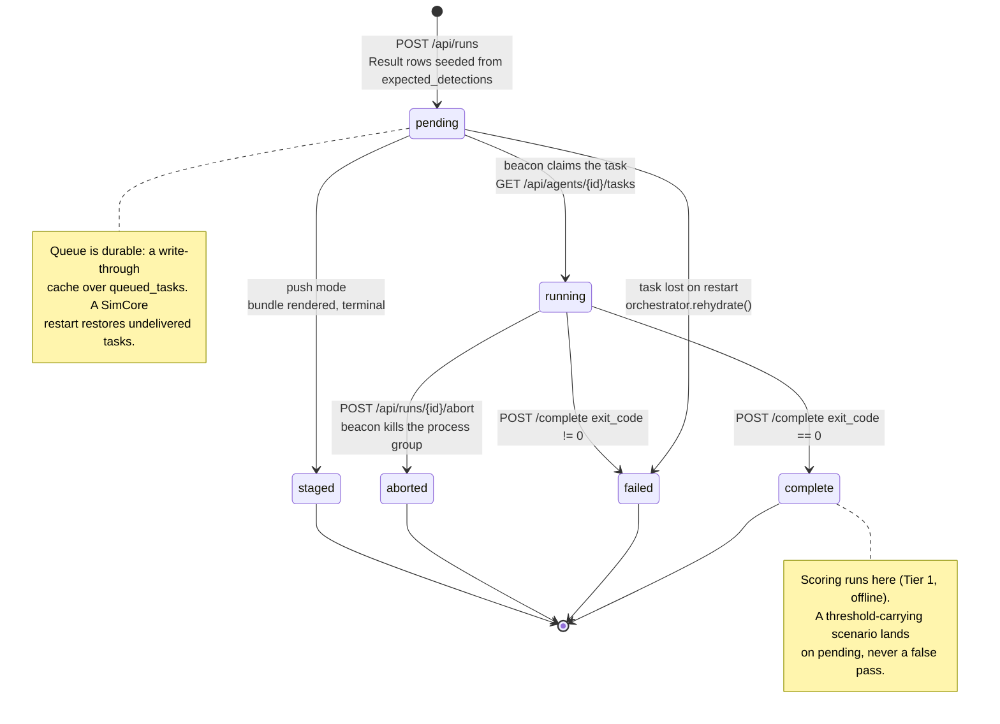
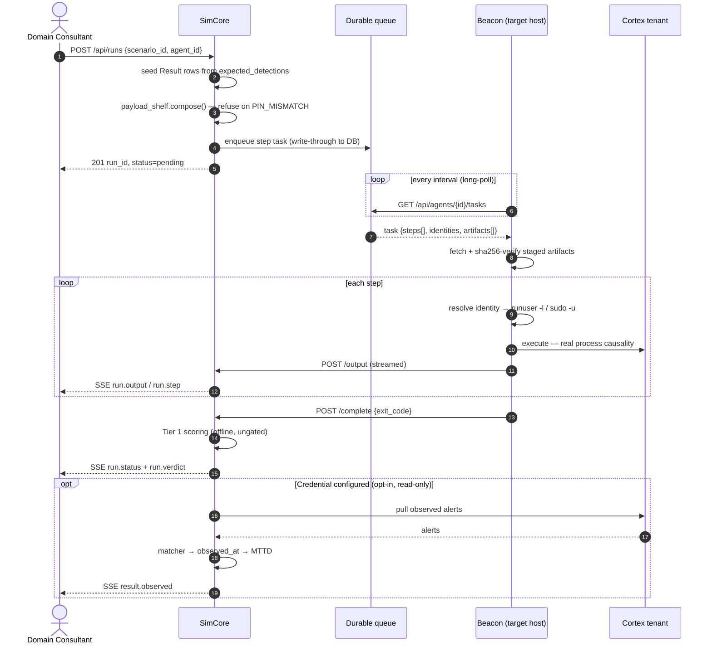
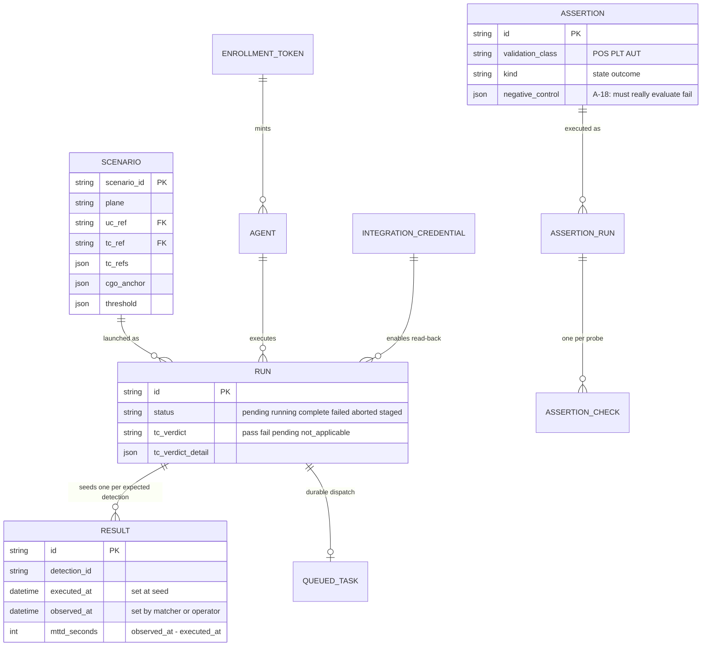
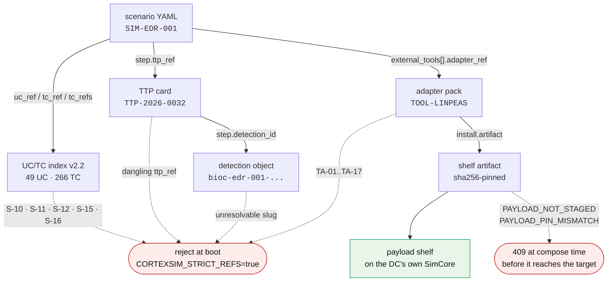
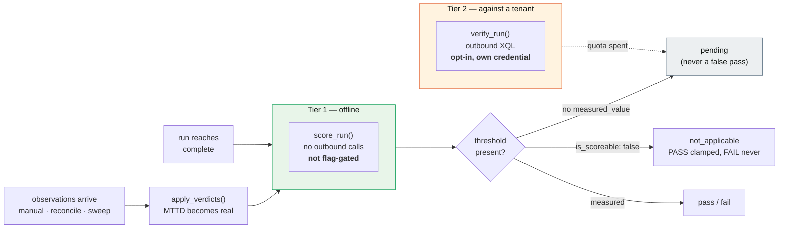

<div align="center">

# CortexSim

**A detection quality-assurance engine for Palo Alto Networks Cortex.**

[](https://github.com/hankthebldr/cortex-pov-engine/actions/workflows/ci.yml)
[](docs/reference/ground-truth.md)
[](docs/reference/ground-truth.md)
[](docs/reference/ground-truth.md)
[](#read-this-before-anything-else)

[](core/requirements.txt)
[](agent/go.mod)
[](ui/package.json)
[](https://github.com/hankthebldr/cortex-pov-engine/wiki)

</div>

CortexSim generates controlled, high-fidelity attack signal into a Cortex
environment (XSIAM/XDR) so a Domain Consultant can validate detection logic —
`BIOC · XQL · Analytics · Correlation · IOC · ABIOC · Prevention` — before a customer's own
SOC has to. Think *"MITRE Caldera's opinionated nephew"*: not a red-team C2, a
**detection quality-assurance engine**.

It runs **199 scenarios across 16 detection planes** through either a pull-model
Go beacon or a self-contained push bundle, under a per-step **identity harness**
so XDR sees real process-causality chains instead of everything running as one
account. Every scenario reference — use case, test case, TTP card, detection id,
tool adapter, staged payload — is a **validated foreign key checked at boot**,
not free text.

> [!IMPORTANT]
> **There is no login and no API key anywhere in this app.** It is built for a
> customer-lab jumpbox where the operating DC already has full admin access.
> Read [No authentication, by design](#no-authentication-by-design) before you
> put it anywhere else.

### Contents

| | |
|---|---|
| [Read this before anything else](#read-this-before-anything-else) | The three things that will mislead you |
| [5-minute quickstart](#5-minute-quickstart) | One command, Docker only |
| [Architecture](#architecture) | System shape, lifecycle, data model, API surface |
| [What makes this more than a script runner](#what-makes-this-more-than-a-script-runner) | The five subsystems that carry the weight |
| [Detection planes](#detection-planes) | What's covered |
| [Deploy an agent](#deploy-an-agent) · [Launch a simulation](#launch-a-simulation) | Operating it |
| [EAL Traffic Simulator](#eal-traffic-simulator) · [AIRS stack](#airs-validation-stack) | Signal the harness can't produce |
| [CI & quality gates](#ci--quality-gates) | What actually protects this |
| [Releases](#releases--packaging) · [Contributing](#contributing) | Shipping it |

---

## Read this before anything else

> [!CAUTION]
> **`tenant-verified` is `0`.**
> No run, no assertion, and no test in this repo has ever executed against a
> live Cortex tenant. Every green checkmark — in `/api/health`, in the console,
> in this file — comes from an injected transport or a local lab container.
> **Authored is not proven.** Connecting a real tenant is opt-in
> (`POST /api/connectors/{kind}/preflight` before any POV) and CortexSim never
> writes to it.

> [!WARNING]
> **A bare `ubuntu:22.04` target cannot run this corpus.**
> Every non-`root` step runs under a service-account identity (`www-data`,
> `postgres`, `svc-backup`, …), and a stock cloud image ships those accounts
> with no login shell. The harness dies in milliseconds, the run reads `failed`,
> and an absent detection under that step reads exactly like *"Cortex missed
> it"* — when nothing was ever executed for Cortex to miss. Use
> [`deploy/tier-d/Dockerfile.target`](deploy/tier-d/Dockerfile.target) for
> anything beyond reading this file, and see
> [Reading a run honestly](#reading-a-run-honestly) before you report a `failed`
> run as a coverage gap.

> [!WARNING]
> **A meaningful slice of the corpus is placeholder.**
> 98 of the corpus's 823 steps are marker-only, pure `echo`/`printf` a sensor
> cannot see (`signal_quality` in
> [`ground-truth.md`](docs/reference/ground-truth.md)), and the
> [lab-readiness manifest](docs/reference/lab-readiness.md) counts 142
> detection-bearing steps that declare `expected_detections` without producing
> the underlying signal. Open a scenario's YAML under `scenarios/{plane}/` and
> read the `command:` lines before you build a POV plan around it.

> [!CAUTION]
> **Windows targets: read first.** The Windows path has run in one place: the
> `windows-2022` CI job, **green** at `d7f4f29` (2026-11-10) and on the
> round-2 code at `e434efa` (run 43037077022, 2026-11-11), on a GitHub-hosted
> runner with Defender real-time protection off and no XDR agent. It ran the beacon's tests, the elevated install
> one-liner, a pull run, an abort and the uninstaller against CI probe
> scenarios. **No shipped scenario, no `.ps1` push bundle and no customer
> endpoint has run it.** Changes made after `e434efa` have not run on
> Windows until the job runs on them.
> - **Product floor:** Windows PowerShell **5.1** (Server 2016+ / Windows 10+).
>   CI parsed every shipped `.ps1` under 5.1 itself; the local gate uses
>   pwsh 7, which is not 5.1.
> - **Run the one-liner elevated.** That installs the `CortexSimAgent` service.
>   Its handler started and stayed Running in CI; reboot survival has not been
>   observed. A non-elevated run is refused
>   (`NOT_ELEVATED`) unless `CORTEXSIM_ALLOW_UNSUPERVISED=1`, and then the
>   beacon dies at logoff and at reboot.
> - **The beacon is unsigned**, and the `iwr | iex` cradle may be blocked or
>   quarantined by XDR/Defender in prevent mode. Get an allow-list entry or
>   exclusion for `C:\ProgramData\CortexSim\cortexsim-agent.exe` and its
>   published sha256 **before** the POV.
> - **Identity collapses to the beacon's own account** (SYSTEM under the
>   service, by its LocalSystem registration), with `IDENTITY NOT HONOURED` in
>   the run record. A lineage-keyed miss is not a customer gap.
> - **Only Windows-resolvable scenarios run**: 13 resolve for Windows and
>   69 carry a Windows-labelled step. **There is no Windows canary**
>   (`CORTEXSIM_CANARY_SCENARIO_LINUX` only).
> - **On a managed host**, a Group Policy execution policy outranks
>   `-ExecutionPolicy Bypass` for a `.ps1` bundle and every child step, and
>   AMSI or the endpoint agent can block the whole file before step 1. The
>   bundle warns (`cortexsim-policy-warning reason=EXECUTION_POLICY_GPO`) but
>   cannot get past either.
>
> Procedure and known issues:
> [`docs/release/mvp-launch-runbook.md`](docs/release/mvp-launch-runbook.md)
> §7–§8.

---
## 5-minute quickstart

```bash
export DOCKER_CONTEXT=default          # only needed if Docker Desktop hijacked your context
git clone https://github.com/hankthebldr/cortex-pov-engine.git
cd cortex-pov-engine
./scripts/dev-up.sh
```

Verified live, at an earlier release (the transcript predates the Host guard):

```
[dev-up] docker: Docker version 29.7.2, build a7dcaa6 — daemon reachable.
[dev-up] .env already present — leaving it untouched.
[dev-up] Building and starting SimCore: docker compose up -d --build
...
[dev-up] Waiting for http://localhost:8888/api/health ...
  ✓ CortexSim is up:  http://localhost:8888
```

That's it — one command, Docker is the only prerequisite. `scripts/dev-up.sh`
needs **no Go/Rust/Node toolchain and no git submodules on your host**: the
image bakes the Go agent matrix, the Rust tools, and the tool-payload shelf
at build time. It's idempotent — re-run it any time; an existing `.env` (and
its generated secret) is never rewritten unless you pass `--apply`. Open
`http://localhost:8888`.

Usage is `scripts/dev-up.sh [--dev] [--apply]`; an unknown argument exits 2
before anything starts. **Re-running it over an `.env` from before the Host
guard** (one with no `CORTEXSIM_ALLOWED_HOSTS`) prints a WARNING block: it
starts compose with this host's short and fully qualified names for that
bring-up only, leaves `.env` untouched, and closes with a
"Still open from this run:" list. `scripts/dev-up.sh --apply` writes the line
instead; its first line reads `.env already present — keeping it; --apply adds
only a missing CORTEXSIM_ALLOWED_HOSTS.`, and the previous file is kept under
`.env-backups/<UTC>/.env`. A plain `docker compose up` afterwards drops an
unpersisted value. Add any other name you use (a CNAME, an `/etc/hosts`
alias, a Tailscale name) by hand. *These paths were driven with stubbed
`docker`, `curl` and `hostname`, not on a jumpbox.* Back up the database
volume before you upgrade an existing install and roll back only by restoring
it: 1.0.2 or older code fails every launch against a database 1.1.0 or later
code created (OPS-17). A 2026-11-12 probe through each version's own ORM, not
through a launch, found 1.1.1 still writes to a database 1.2.0 created or
upgraded ([runbook §8.5](docs/release/mvp-launch-runbook.md)).

**A `degraded` status on first boot is normal, not broken** — it almost
always just means no agent has enrolled yet:

```bash
curl -s http://localhost:8888/api/health | python3 -m json.tool
```

`GET /api/health` is the one diagnostic surface, and it obeys one rule: it
never reports green for something it didn't check. Read the `code` and
`detail` on any non-`ok` component before you treat `degraded` as a problem —
`dev-up.sh` itself prints them for you. A genuinely empty catalog (`count: 0`
on scenarios or adapters) is the one shape of `degraded` that means something
is actually wrong — see `docs/reference/lab-runbook.md` for the full read.

No Docker on this host, or the daemon/registry unreachable (sandboxed CI,
cloud dev container)? `./scripts/dev-up-native.sh` is the Docker-free twin —
generates `.env`, builds the venv, builds the UI, launches SimCore natively
on `${CORTEXSIM_BIND:-0.0.0.0}`, polls the same health endpoint.

From here: [deploy an agent](#deploy-an-agent) →
[launch a simulation](#launch-a-simulation).

---

## Two ways to get CortexSim running

Both paths below start with a plain `git clone` — **do not** pass
`--recurse-submodules`. Two of the nine registered submodules
(`sources/CDR`, `sources/xsiam-prisma-cdr-lab`) live in repos that may be
private/org-restricted; a plain clone sidesteps the question entirely, and
each script below handles submodules on its own terms.

### Container path — recommended, what's tested above

```bash
git clone https://github.com/hankthebldr/cortex-pov-engine.git
cd cortex-pov-engine
./scripts/dev-up.sh
```

Needs only Docker (+ internet for the *first* build, to pull base images and
language deps — nothing after that). No submodules touched, no toolchain
installed on your host. This is the path verified live above and the one the
rest of this README assumes.

CortexSim ships as tagged GitHub Releases — **v1.2.0** is the release this
tree describes, cut 2026-11-12 and tagged by `tag-on-main.yml` when it merges
to `main` (until that tag exists, **v1.1.1** is the latest published) — and
the release pipeline pushes a multi-arch image
(`ghcr.io/hankthebldr/cortexsim`, linux/amd64 + linux/arm64) to GHCR. That
image is **not publicly pullable today** (an anonymous pull-token request is
denied), so don't `docker pull` it — see
[Releases & Packaging](#releases--packaging). `scripts/dev-up.sh` builds the
equivalent image locally from the tree, and is the working path right now.

### Source build path — contributors, or building the toolchain itself

```bash
git clone https://github.com/hankthebldr/cortex-pov-engine.git
cd cortex-pov-engine
./install.sh
```

`install.sh` is the developer path: it installs a Go/Rust/Node/Python
toolchain on the host, initializes all nine submodules, and builds every
component from source (agent, Rust tools, React UI) before bringing up
Docker Compose. Use it when you're modifying the toolchain itself, not to
just run CortexSim. Requires Ubuntu 22.04 LTS+ or Debian 12+. Its closing
banner prints the by-name URL only when `CORTEXSIM_ALLOWED_HOSTS` admits that
name; otherwise it leads with `localhost` and adds a
`By name: … refused (400 HOST_NOT_ALLOWED)` note saying how to admit it.
`install.sh` does not write `.env`.

If `sources/CDR` or `sources/xsiam-prisma-cdr-lab` are inaccessible to your
GitHub account, `install.sh` now **degrades to a named warning and
continues** — it used to abort the entire bootstrap (Go build, Rust build, UI
build included) on that one private-submodule 404; that's fixed. Nothing
else in the installer depends on either submodule.

---

## Architecture

Three tiers and a signal-injection subsystem. SimCore is the only stateful
component; both delivery surfaces are designed to work when the target host
has no toolchain and no internet.



### The three delivery surfaces

| | **Pull** | **Push** | **EAL** |
|---|---|---|---|
| Vehicle | Go beacon polls SimCore | Rendered self-contained bundle | Plugin emits to a collector |
| Target needs | nothing — beacon is served + sha256-verified | `bash` (or Windows PowerShell 5.1, unproven) | network path to the collector |
| SimCore at runtime | required | **none** | required (or use the offline bundle) |
| Identity harness | ✅ POSIX only (Windows: `IDENTITY NOT HONOURED`) | ✅ POSIX only | n/a — log/traffic shapes |
| Live progress | ✅ SSE | ✗ offline | ✅ SSE |
| Abort mid-run | ✅ kills process group (Windows: Job Object, unproven) | ✗ | ✅ |
| Terminal state | `complete` / `failed` / `aborted` | `staged` | campaign `delivery_verdict` |
| Use when | you own the box | air-gapped / default-deny | the harness can't make that signal |

### The run lifecycle



> [!NOTE]
> A pull-mode run sits at **`running`**, not `pending`, while it waits for the
> beacon to poll — `completed_at: null` and no output. Grepping for `pending`
> finds nothing. See [Run hanging at `running`?](#run-hanging-at-running)

### Pull mode, end to end



### Live event surface

`GET /api/events` (global) and `GET /api/runs/{id}/events` (scoped) stream
Server-Sent Events. Seven frame types drive the console with no polling:

| Frame | Emitted when | Carries |
|---|---|---|
| `run.status` | state transition | new status, timestamps |
| `run.step` | a step starts/ends | step id, identity, exit code |
| `run.output` | beacon streams stdout/stderr | chunk, stream, sequence |
| `run.verdict` | scoring completes | `tc_verdict` + detail |
| `result.observed` | matcher or operator validates a detection | `observed_at`, `mttd_seconds` |
| `agent.status` | heartbeat sweep flips online/stale/offline | agent id, `last_seen` age |
| `agent.install` | installer posts a stage code | stage, exit code |

### Evidence data model

16 ORM models; these are the ones that carry evidence. `Result` is the unit
that turns into MTTD — one row per expected detection per step, seeded at
launch with `executed_at`, closed by `observed_at`.



### API surface

**163 route decorators across 29 router files** (`docs/reference/ground-truth.md`, `http_routes`); the app serves **173 routes**, counted with the walker in [`api-and-agent-surface.md`](docs/reference/api-and-agent-surface.md) §0 (163, plus the six shelf artifact routes a helper registers on both `/api/k8s` and `/api/shelf` without a decorator, plus FastAPI's four docs routes). Interactive docs ship with the app at
`/api/docs` (Swagger) and `/api/redoc`.

<details>
<summary><b>Routes by module</b> — click to expand</summary>

| Module | Routes | What it owns |
|---|---:|---|
| `agents` | 16 | enrollment tokens, install / uninstall script + telemetry, task claim, binary matrix, preflight |
| `runs` | 16 | launch, output, complete, abort, control, pair, canary, verify, case-ledger refresh, report export |
| `eal` | 16 | campaigns, collectors, preflight, offline bundle |
| `xsiam` | 11 | 152-op gated operation catalog (writes preview) + Tier-2 XQL + issue, case and endpoint reads |
| `credentials` | 10 | encrypted integration vault |
| `uctc` | 9 | the FY27 v2.2 index, read-only, joined to engine evidence |
| `ttps` | 8 | TTP cards, detection objects, ATT&CK Navigator export |
| `tools` | 8 | adapter catalog, tool instantiation |
| `drafts` · `payloads` | 7 each | Composer drafts · the shelf, mounted at `/shelf` and `/k8s` |
| `assertions` · `scenarios` | 6 each | POS/PLT/AUT artifacts, probes, runs (`rejected[]` surfaced) · corpus, bundle download |
| `collector_targets` | 6 | the collector targets the EAL emitters POST to, with preflight |
| `results` · `infra` · `connectors` | 4 each | detection validation → MTTD · IaC bundle generation · preflight / reconcile / observations |
| `tools_dist` · `pov` · `doors` · `ngfw` · `prerequisites` | 3 each | binaries · entitlement scoping · ingestion doors (read-only) · read-only PAN-OS connection · dataset requirements and query library |
| `mitre` · `events` · `tenant_evidence` | 2 each | coverage heatmap · SSE · run tenant evidence |
| `storyline` · `health` · `causality` · `readiness` | 1 each | run narrative · diagnostics · causality graph · connector ladder |

Counted 2026-11-13 by `@router.*` decorator per file with the generator's own
pattern; only the total (163) is regenerated into the ground truth.

</details>

> [!TIP]
> `GET /api/health` is the one diagnostic surface and it obeys one rule: **it
> never reports green for something it didn't check.** It makes zero outbound
> calls, publishes `not_checked[]` naming the six reachability-shaped claims it
> deliberately does *not* make, and treats a zero as `degraded` — booting
> without `tools/` used to report `{status: ok, count: 0}` while every
> `adapter_ref` in the corpus was unresolvable.

---
## What makes this more than a script runner

Five subsystems carry the weight. Each exists because of a specific way a
detection-validation tool can lie to a customer.

### 1 · Every reference is a validated foreign key

A scenario doesn't *mention* a use case, a TTP, or a tool — it **binds** to one,
and the binding is checked at boot under `CORTEXSIM_STRICT_REFS` (**default
true**). Free-text drift is the mechanism by which a POV report ends up
describing coverage that doesn't exist.



Three independent code families enforce it, each owning its own namespace so a
failure names the thing that broke:

| Family | Range | Guards | Enforced by |
|---|---|---|---|
| `S-` | `S-01..S-30` | scenario schema, UC/TC binding, staging paths, indicators (`S-22..S-27`), platform-label lint (`S-28..S-30`, warnings) | `core/engine/scenario_loader.py` |
| `A-` | `A-01..A-24` | assertion structure + provability | `core/engine/assertions.py` |
| `TA-` | `TA-01..TA-17` | adapter packs, artifact vs exemption | `core/tools/adapter_loader.py` |

`make check-refs` walks the **real corpus through the real loader** in strict
mode — that gate is what makes the enforcement mean anything.

### 2 · Identity harness + causality contract

Every step runs under a realistic service account (`www-data`, `postgres`,
`svc-backup`, `node`, `nobody`), wrapped with `runuser -l` / `sudo -u` /
`su -s /bin/bash`. Push and pull resolve identity from **one shared spec**
(`spec/identity_harness.json`); a Go test guards the drift.

The point isn't realism for its own sake — it's that XDR's causality graph is
only meaningful if the process tree is. Declaring `cgo_anchor` plus per-step
`causality` collapses the synthetic `cortexsim-agent` star into a connected
CGO → process → process spine.

> [!WARNING]
> **Windows never fakes identity.** There is no credential-free unattended
> impersonation on Windows, so `identity.ResolveFor` collapses every non-direct
> identity to `direct` and writes an explicit `IDENTITY NOT HONOURED`
> degradation **into the run record** — not just a log line. A Windows beacon
> registers `["shell","powershell"]` and does **not** claim `identity-harness`.

### 3 · The payload shelf

<details>
<summary><b>Why a tier-4 tool download is a false-negative generator</b> — click to expand</summary>

Every tier-4 adapter installs its tool **from the public internet, on the target
host, at dispatch** (`command -v hydra || apt-get install -y hydra`). Customers
who buy Cortex run default-deny egress — that is the first thing their network
blocks. A step whose tool never arrived **runs anyway**, produces no detection,
and the absent detection reads in a POV report as *"Cortex missed it"*: a
manufactured false negative on the customer's own stack, in a document a DC
shows that customer.

The shelf stages digest-pinned artifacts on the DC's **own** SimCore. One
resolver walks `scenario → adapter_ref → pack → artifact → shelf` and **refuses
at compose time** with `PAYLOAD_NOT_STAGED` or `PAYLOAD_PIN_MISMATCH` (409) —
before anything reaches the target.

**The integrity model:** the digest is recomputed from the shelf bytes at compose
time and baked into whatever the consumer carries. The consumer verifies against
a value it **carried in**, never one it fetched from the server it is trusting.

**The rename negative control:** the destination path is overridable (never the
shelf key). Stage `linpeas` as `/tmp/.cache/sysinfo.sh` and the filename-keyed
BIOCs correctly go dark while the behavioural ones must still fire. Every rename
emits `FILENAME_KEYED_DETECTIONS_SUPPRESSED` stating the inverted reading — so
"nothing fired" is reported as *coverage is name-keyed*, not *the TTP didn't run*.

State: **91 packs · 8 shelf-staged · 48 exemption-declared · 0 undeclared.**
`TA-13` *rejects* a tier-4 pack declaring neither an artifact nor an exemption —
a reject, not a warn, because a boot warning is how 48 packs came to share one
byte-identical non-explanation.

</details>

### 4 · Assertions — proof for things a detection can't prove

140 rows in the FY27 index are **not detections** and cannot be closed by
authoring more scenario YAML. POS asks whether a posture state *holds*; PLT
whether a capability is *present*; AUT whether an outcome lands *inside a
budget*. These get assertion artifacts, scored by **the same verifier** as
scenarios — no parallel scorer.

> [!IMPORTANT]
> **An assertion that cannot fail does not load — proven by execution at load
> time.** `A-17` builds measurements across the probe's declared domain
> (`count` [0,∞), `percent` [0,100], `ratio` [0,1] …) plus the neighbourhood of
> the authored threshold, pushes each through the *real* evaluator, and rejects
> the artifact unless it produces **both** a pass and a fail. `expected_rows_min: 0`
> on a row count is refused with *"this check can never fail and therefore proves
> nothing."* `A-18` additionally requires an authored `negative_control` and
> proves that value really evaluates `fail`.

Five read-only XQL probes ship — `xql_rows`, `xql_distinct`, `xql_scalar`,
`xql_ratio` (refuses to call 0-of-0 100%), `xql_latency` (measures in the
*platform's* clock, never wall-clock). Thresholds live in the artifact, never in
the query: `| filter sla <= 300` returns zero rows for a tenant that took 412s,
indistinguishable from one that never responded.

**No tenant is never green.** No integration / unreachable / 401 / 429 / bad
dataset / `PRECURSOR_MISSING` / `POPULATION_EMPTY` / dry run all resolve
**`pending`**. Only `NOT_ENTITLED` resolves `not_applicable` — collapsing "still
owed" into "unscoreable by construction" would let unproven claims vanish into a
bucket that reads benign.

### 5 · Two-tier scoring and the measurement loop



Tier 1 is deliberately **not** flag-gated — gating it would gate honesty, not
risk. Tier 2 needs its own flag *and its own credential kind* (`xsiam_tenant`,
not reconcile's `xsiam`): configuring alert read-back does not authorise XQL.
Quota discipline is explicit — max attempts, exponential backoff capped at 4h,
per-sweep query cap, and a circuit breaker; **a spent budget degrades to
`pending`, never `fail`.**

> [!NOTE]
> **Quantified limit:** **134 of 177** scenarios (counted 2026-10-19, before the 12 stitched chains) declare a primary KPI the
> scorer can be given a measured value for — **66** MTTD-shaped, **47** Detection
> Accuracy and **21** correlation rate, the last two derived from the alert
> read-back since sprint 2. The other **43** declare thresholds nothing produces
> a `measured_value` for (Causality Chain Completeness, Asset Discovery Coverage
> and a long tail), so they score `pending` permanently. Measurable is not
> measured: accuracy and correlation need a reconcile pull against a tenant,
> and `tenant-verified` is still 0.

---
## Detection planes

> [!NOTE]
> Counts here are **machine-generated** by `python3 scripts/generate_ground_truth.py`,
> which cross-checks every number two independent ways and is gated in CI —
> `make check-ground-truth` fails a PR whose committed copy drifted from the
> corpus on disk. Full breakdown (per-type, MITRE, adapters, assertions):
> **[`docs/reference/ground-truth.md`](docs/reference/ground-truth.md)** ·
> machine-readable: [`ground-truth.json`](docs/reference/ground-truth.json).

| Plane | Cortex engine | Scenarios | Primary driver |
|---|---|---:|---|
| CDR | Cortex Cloud / Prisma Cloud Compute | 28 | container-runtime exec · K8s manifests |
| Analytics | XSIAM Correlation Engine | 38 | multi-plane stitching |
| EDR | Cortex XDR Agent | 25 | identity harness · signalbench |
| ITDR | Cortex ITDR | 20 | AD toolchain · `idp_signin_emulator` |
| NDR | Network Security / Firewall Analytics | 12 | EAL network plugins |
| KOI | Agentic endpoint / supply-chain | 12 | `agentic_egress` + artifact pack |
| Cloud App | Cortex Cloud App Security | 10 | `oauth_grant_emulator` |
| TIM | Cortex Threat Intel Management | 9 | mocktaxii · IOC feeds |
| AI_SPM | Cortex AI Security Posture Management | 7 | `ai-spm` IaC planted findings |
| ASM | Cortex Attack Surface Management | 6 | `asm` IaC exposed surface |
| AI_ACCESS | Cortex AI Access Security | 6 | `llm_provider_egress` |
| Browser | Prisma Browser | 6 | `browser_attack_runner` (Playwright) |
| AIRS | Cortex AI Runtime Security | 5 | `cortex-prompt-attacker` |
| CSPM | Cortex Cloud Posture Management | 5 | `cspm` IaC misconfigs |
| Email | XSIAM / NG-SIEM (3rd-party ingestion) | 5 | `email_emitter` |
| DLP | Data Security (DSPM · DDR · Endpoint DLP) | 5 | endpoint + cloud data movement |
| **Total** | | **199** | |

**1,411 step-level expected detections** resolve against **2,260 catalog
detection objects** across the seven-value `detection_type` vocabulary
(`Prevention` is the seventh, with 3 step-detections today), covering
**239 MITRE techniques (128 base)**. XDM modeling rules are a normalization
*substrate*: surfaced and exported, counted informationally, not a detection type.

<details>
<summary><b>Step-detections by type</b></summary>

| Type | Count | What it is |
|---|---:|---|
| `XQL` | 554 | query-defined detection |
| `BIOC` | 374 | behavioral IOC |
| `ABIOC` | 163 | PANW-authored, auto-tuned behavioral ML with a causality chain |
| `Correlation` | 142 | multi-source stitched rule |
| `IOC` | 119 | atomic indicator |
| `Analytics` | 56 | baseline-deviation analytic |
| `Prevention` | 3 | agent prevention-module block (two-witness rule) |
| **Total** | **1411** | `docs/reference/ground-truth.md` → `step_detections_by_type` |

</details>

---
## Deploy an agent

Two calls: mint a token against SimCore, then run the one-liner it gives you
**on the target** — the jumpbox you want to generate signal on, not the host
running SimCore.

```bash
# 1. Mint a short-lived, single-use enrollment token
curl -fsS -X POST -H 'Content-Type: application/json' \
  -d '{"ttl_seconds":900,"max_uses":1,"label":"my-jumpbox"}' \
  http://localhost:8888/api/agents/enroll/tokens
```

Verified live this session:

```json
{"id":34,"token":"cxs_DFNcubHUIm985G8Mv2e4TaT8awUIqHEROyO13N6WkM0",
 "label":"readme-verify","expires_at":"2026-08-31T21:14:10.331093",
 "max_uses":1,"remaining_uses":1,"revoked":false}
```

```bash
# 2. On the TARGET jumpbox — installs as a supervised service by default
curl -fsSL 'http://<simcore-host>:8888/api/agents/install?os=linux' \
  | CORTEXSIM_TOKEN='cxs_...' bash
```

Replace `<simcore-host>` with SimCore's **routable** address, not
`localhost` — pasted on a remote jumpbox, `localhost` resolves to the
jumpbox itself and the beacon "installs successfully" while talking to
nothing. A DNS name must also be in SimCore's `CORTEXSIM_ALLOWED_HOSTS`: the
installer route refuses one the Host guard would refuse
(`400 SERVER_HOST_NOT_ALLOWED`), and the script names a refusal at enroll as
`HOST_NOT_ALLOWED`. Put the token in the env var, not a `?token=` query
param — the query form works but bakes a live credential into the URL, the
served script and any proxy log. The env-var form still leaves the pasted
line in shell history, so mint single-use, short-TTL tokens.

No compiler and no public-internet egress are required on the target — the
script downloads a **prebuilt** beacon from this same SimCore and
sha256-verifies it. Verified live, this SimCore serves the full five-target
matrix today:

```json
{"binaries":[
  {"os":"linux","arch":"amd64"},{"os":"linux","arch":"arm64"},
  {"os":"darwin","arch":"amd64"},{"os":"darwin","arch":"arm64"},
  {"os":"windows","arch":"amd64"}], "total":5}
```

macOS is `os=darwin`. Windows gets a PowerShell installer at `os=windows`;
see **Windows targets** below before you use it. Confirm the beacon checked in:

```bash
curl -s http://localhost:8888/api/agents | python3 -c '
import sys, json
for a in json.load(sys.stdin)["agents"]:
    print(a["agent_id"], a["status"], a["os"], a["last_seen_age_seconds"], "s ago")'
```

**Check `last_seen_age_seconds`, not just `status`.** `status` derives from
`last_seen` age (`online` < 30s / `stale` < 5min / `offline` ≥ 5min), but a
freshly-enrolled agent gets `last_seen` stamped at enrollment time — before
its beacon has polled even once. That reads `online` for the first 30
seconds whether or not a real beacon is actually running: a re-install that
rewrote a systemd unit without restarting the old process (fixed, but check
your installer's version) would print `online` for a phantom id the whole
window. If `last_seen_age_seconds` isn't dropping toward zero on repeat
calls a few seconds apart, nothing is actually polling — full detail in
[`docs/reference/agent-deployment.md`](docs/reference/agent-deployment.md) §4.

Full detail is written up in
**[`docs/reference/agent-deployment.md`](docs/reference/agent-deployment.md)**:
`?mode=` semantics, the loopback trap, and the identity-harness false negative
this step exists to close. Uninstall a POSIX beacon as the user who installed
it, `curl -fsSL '<server>/api/agents/install?uninstall=1' | bash`, or with
`| sudo bash` for a root install (which also removes user-mode installs under
`SUDO_USER`, `/home` and `/Users`). Deleting an agent row that still has runs
owed or in flight is refused with `409 AGENT_HAS_OPEN_RUNS`; abort those runs
first.

### Windows targets — read first

> [!WARNING]
> **Run in CI, not on a customer host.** The `windows-2022` CI job ran
> the elevated path below green, most recently at `e434efa` (run 43037077022),
> on a GitHub-hosted runner with no XDR agent. Floor: Windows PowerShell 5.1.

From **Windows PowerShell opened as Administrator** (the console emits this
line, TLS 1.2 opt-in included):

```powershell
[Net.ServicePointManager]::SecurityProtocol = [Net.ServicePointManager]::SecurityProtocol -bor 3072; $env:CORTEXSIM_TOKEN='cxs_...'; iwr -useb "http://<simcore-host>:8888/api/agents/install?os=windows" | iex
sc.exe query CortexSimAgent      # STATE : 4  RUNNING; log at %ProgramData%\CortexSim\agent.log
```

- Elevated, it installs the `CortexSimAgent` service. Its SCM handler started
  and stayed Running in CI; reboot survival is unobserved. `OK` needs the
  service still Running 35 s later and a real check-in. One install has been
  timed, at about 47 s; allow up to about 70 s (the installer's own waits).
- Behind a proxy, set a machine-level `CORTEXSIM_AGENT_PROXY`: the SYSTEM
  service does not inherit yours, and the beacon does not read the Windows
  system proxy.
- The console also offers a download-then-run path (installer and beacon
  links, digest, a `Get-FileHash` check) for hosts where `iwr | iex` is
  blocked. It has not run on Windows.
- Not elevated, it is refused with `NOT_ELEVATED`, unless
  `CORTEXSIM_ALLOW_UNSUPERVISED=1`, in which case the beacon is per-user and
  **dies at logoff and at reboot**.
- The exe is **unsigned**. Get an XDR/Defender exclusion for
  `C:\ProgramData\CortexSim\cortexsim-agent.exe` and its sha256
  (`GET /api/agents/binary/sha256?os=windows&arch=amd64`) before the POV.
- Steps run as **SYSTEM** (the service is LocalSystem; each Windows step frame
  names the account it ran as). Every declared identity collapses to it, with
  `IDENTITY NOT HONOURED` in the run record.
- If you reach SimCore by DNS name, that name must be in SimCore's
  `CORTEXSIM_ALLOWED_HOSTS`, or every poll is `400 HOST_NOT_ALLOWED`.
- Uninstall, elevated:
  `iwr -useb '<server>/api/agents/install?os=windows&uninstall=1' | iex`. A
  per-user beacon is removed by the account that installed it, from a normal
  PowerShell; an elevated run only reports another profile's beacon.

Full procedure, `sc.exe` exit readings, push `.ps1` bundles and the beta
known-issues list: [`docs/release/mvp-launch-runbook.md`](docs/release/mvp-launch-runbook.md)
§7–§8.

---

## Launch a simulation

**Ask the target first.** `GET /api/agents/{agent_id}/preflight` answers "can
this host run this scenario?" from what the beacon registered (interpreters,
capabilities) before you spend a run on it:

```bash
curl -s "http://localhost:8888/api/agents/<agent_id>/preflight?scenario_id=SIM-EDR-001"
# -> {"agent_id": ..., "scenario_id": "SIM-EDR-001", "ready": true|false, "gaps": [...], ...}
```

It cannot see a missing login shell. `SIM-EDR-001` runs under `www-data`, so
on a stock cloud image it fails in milliseconds whatever the preflight says
(the warning at the top of this file). Launch it against the
[`deploy/tier-d`](deploy/tier-d/Dockerfile.target) target, or start with a
scenario whose steps run as root: on 2026-11-10 `SIM-EDR-008` ran 3 of 3 steps
with exit 0 on a stock Ubuntu 24.04 VM with a Cortex XDR agent, against a
SimCore with no tenant credential, so its 12 Results stayed `pending`.

```bash
curl -s -X POST http://localhost:8888/api/runs -H "Content-Type: application/json" -d '{
  "scenario_id":"SIM-EDR-001","mode":"pull",
  "target_agent_id":"<agent_id from /api/agents>",
  "consent":{"simulation_authorized":true}
}'
```

A 200 can still carry `warnings[]`, for example `TARGET_AGENT_OFFLINE` when the
target's beacon is not polling: the task waits in the queue, and the warning
is also written onto the run.

**The `consent` gate is real, at both `pull` and `push` mode** — a scenario
that binds a dual-use adapter (e.g. Atomic Red Team) is refused `409
CONSENT_REQUIRED` without `simulation_authorized: true`. Don't script around
it. It does **not** cover the raw bundle-download endpoint
(`GET /api/scenarios/{id}/download`) — a downloaded bundle carries dual-use
tooling with no prompt, by design; keep that in mind before handing one to
someone else.

No agent, or want a bundle with no SimCore dependency at runtime instead?

```bash
curl -s -OJ -D - "http://localhost:8888/api/scenarios/SIM-EDR-001/download?format=auto" \
  | grep -i '^x-cortexsim-bundle-target'
```

`format=auto|bash|powershell|k8s`. `auto` prefers POSIX and falls back to
PowerShell for a Windows-only scenario, so name the saved file by the
response, not by habit: `-OJ` keeps the server's `Content-Disposition`
filename (`.sh` or `.ps1`), and `X-CortexSim-Bundle-Target` says `posix` or
`windows`. `GET /api/scenarios/{id}` says which targets a download will serve
(`bundle_targets`): 190 scenarios serve bash and 13 serve PowerShell (9 serve
both), and 5 serve neither, because `SIM-EDR-023` / `-024` and `SIM-MP-030` /
`-031` / `-034` are `push_supported: false` (counted 2026-11-12 through the real
loader and the route's own `_bundle_targets`). A raw download creates no Run and no Result rows;
launch with `"mode":"push"` when you want a run to score. A Windows `.ps1` runs with
`powershell.exe -NoProfile -ExecutionPolicy Bypass -File .\cortexsim-<id>.ps1`,
after `Unblock-File` if Mark-of-the-Web policy requires it. It exits non-zero
when any step failed or did not run, and refuses to start on cleanup residue
unless `CORTEXSIM_ACCEPT_RESIDUE=1`. **None of the 13 shipped `.ps1` bundles
has executed on Windows yet**: CI parsed them under 5.1 and ran a probe
bundle. A push run has no host, so reconcile it with `?host=<endpoint>`;
otherwise its matches stay `pending` (`UNSCOPED_MATCH`).

### From run to verdict

A completed run is not yet a measurement. Its Results stay `pending` until
alerts are matched to them, and only then do MTTD and the test-case verdict
mean anything. Two ways in, both through the same matcher:

```bash
# Offline: paste alerts you exported from the Cortex console. Each needs its own
# timestamp (observed_at / timestamp / time, ISO-8601 or epoch); a row without a
# readable time is dropped and counted, never stamped "now".
curl -s -X POST "http://localhost:8888/api/runs/<run_id>/observations" \
  -H 'Content-Type: application/json' -d '{
  "host": "<endpoint hostname>",
  "observations": [
    {"observed_at": "2026-11-10T21:04:12Z", "name": "<alert name>",
     "host": "<endpoint hostname>", "techniques": ["T1003.001"],
     "detection_id": "<rule or BIOC id>", "alert_source": "XDR BIOC",
     "external_id": "<alert id>"}
  ]}'

# Credential-backed: pull the run's window from a registered tenant.
curl -s -X POST "http://localhost:8888/api/runs/<run_id>/reconcile?connector=xsiam&host=<endpoint hostname>"

# Then the report.
curl -s "http://localhost:8888/api/runs/<run_id>/report?format=markdown" -o pov-<run_id>.md
```

`host` scopes the match to the endpoint the run executed on; without it a push
run's matches stay `pending` / `UNSCOPED_MATCH`, with no MTTD. MTTD is measured
from launch to the alert's own time, so it includes queue wait and earlier
steps (open decision OPS-07). Do not use `PUT /api/results/{id}/validate` for
MTTD: a click records click latency. Full walkthrough:
[`docs/reference/launching-a-simulation.md`](docs/reference/launching-a-simulation.md).
`tenant-verified` is 0: no run in this repo has been matched against a live
tenant.

### Run hanging at `running`?

A pull-mode run's own `status` stays `running` — with `completed_at: null`
and no `output` — for as long as the target agent hasn't polled. That is
**not** the same as `pending`; grepping a run for `pending` finds nothing.
Check the queue directly:

```bash
curl -s http://localhost:8888/api/health | python3 -c '
import sys, json
print(json.load(sys.stdin)["components"]["task_queue"])'
```

A `degraded` / `TASKS_QUEUED_FOR_UNAVAILABLE_AGENT` result names which
agent(s) the queue is stuck on. It's not lost — the queue is durable and
survives a SimCore restart — but nothing will collect the task until that
agent is actually online (see "Confirming the beacon is live" above; check
`last_seen_age_seconds`, not just `status`).

### Reading a run honestly

Trust the **console's live Run Detail / Storyline view** to distinguish an
unrun step from a real Cortex miss — it's verified correct: a `failed`/
`aborted` run banners *"coverage figures on this run are not a measurement of
the tenant's detections"* above every tab, and the Storyline view downgrades
every un-reviewed detection on an unproven run from `missed` to
`not-executed`.

**Do not** trust that same silence in the **exported** markdown/JSON POV
report, or in a **push-mode** bundle for a scenario declaring
`requires_interpreters` — both were verified this repo's own hardening pass
to render a silent false success today (a missing-interpreter refusal that
the pull-mode beacon correctly reports as `RUNTIME_DEPENDENCY_MISSING` has no
equivalent in `push_generator.py`, and the exported report's own integrity
check doesn't look for that marker yet). Full walkthrough, run against a real
beacon and a real Tier-D target, both gaps reproduced live with verbatim
output:
**[`docs/reference/launching-a-simulation.md`](docs/reference/launching-a-simulation.md)**.

For a fully automated, re-runnable proof that classifies a run's failures
into **ENGINE** (a real CortexSim defect) / **ENVIRONMENT** (the target
couldn't support the step — not a Cortex miss) / **TTP** (the technique ran
for real), run the Tier-D harness before you're in front of a customer:

```bash
export DOCKER_CONTEXT=default
deploy/tier-d/run-tier-d.sh --scenario SIM-EDR-001
```

---

## EAL Traffic Simulator

A plugin-based subsystem under `core/eal_simulator/` that emits controlled
network/log telemetry to validate NGFW Enhanced Application Logs and
Cortex analytics without hand-rolling raw traffic. 27 plugins today, split
into two families: **signal-injection** (C2 beacon, DNS tunnel, OAuth grant
abuse, LLM-provider egress, browser attacks, agentic supply-chain fetches)
and the **analytics log-streamer** family, which POSTs shape-true
audit/log JSON (AWS/GCP CloudTrail, Azure Activity, Kubernetes audit, M365,
AD/Windows security, NGFW EAL, Okta/Entra sign-in) to an operator-supplied
collector so a customer can validate Analytics/ABIOC detections against
their real ingestion pipeline.

```bash
python -m scripts.eal_simulator.cli list-plugins | jq .
python -m scripts.eal_simulator.cli run path/to/campaign.yml --live
```

Delivery is accounted, not assumed — only a genuine `2xx` from the collector
counts as delivered; `GET /api/eal/campaigns/{id}/preflight` answers "will
this ingest?" before a customer is watching. Emitting from *inside* a
customer network with no SimCore at runtime: `POST
/api/eal/campaigns/{id}/bundle` (stdlib-only `urllib`, no pip install).

---

## AIRS validation stack

For AI Runtime Security POVs, a self-contained canary + attacker pair so the
customer's AIRS layer can be validated with no real LLM, keys, or external
dependency:

```bash
cortex-vulnerable-llm serve --port 8089 --vuln all
cortex-prompt-attacker run --probes scenarios/airs/probes/llm01/ \
  --target-url http://127.0.0.1:8089/owasp/llm01/chat \
  --scorers system_prompt_leak,secret_leak --out /tmp/airs-001.jsonl
```

`sources/cortex-vulnerable-llm/` — Flask app, one blueprint per OWASP LLM
Top 10 class, deterministic regex canary, no real LLM calls ever.
`sources/cortex-prompt-attacker/` — Probe → Mutator → Target → Scorer
pipeline; promptmap-compatible probe YAML (schema only, no GPL import);
JSONL output mirrors garak's `Attempt` shape.

---

## Repository layout

```
cortex-pov-engine/
├── scripts/dev-up.sh         ← THE canonical bring-up (Docker only)
├── scripts/dev-up-native.sh  ← Docker-free twin
├── install.sh                ← full source bootstrap (contributors)
├── core/                     ← SimCore FastAPI app (Python 3.11)
│   ├── api/                    29 router files · 163 route decorators · 173 served routes
│   ├── engine/                 41 modules — loader · orchestrator · verifier
│   │                           payload_shelf · assertions · causality_graph
│   │                           push_generator · uctc_registry · storyline
│   ├── connectors/             opt-in read-back measurement loop
│   ├── integrations/xsiam/     152-op gated operation catalog (writes preview) + Tier-2 XQL
│   ├── integrations/panos/     read-only NGFW (PAN-OS) connection
│   ├── mcp_server/             MCP server, 54 tools (stdio, or opt-in HTTP at /mcp)
│   ├── eal_simulator/          27 plugins, two families
│   ├── planes/                 declarative PlaneDescriptor registry (15; dlp.py unregistered)
│   └── models.py               20 ORM models
├── agent/                    ← Go beacon, stdlib only, 5-target matrix
├── ui/                       ← React 18 + Vite console
├── scenarios/                ← 199 scenario YAML, per plane
├── assertions/{pos,plt,aut}/ ← POS · PLT · AUT artifacts
├── detection_scanner/ttps/   ← 197 TTP cards → 2,260 detection objects
├── tools/packs/              ← 91 adapter packs across 5 tiers
├── payloads/                 ← digest-pinned shelf (manifest is generated)
├── infra/modules/aws/        ← 11 Terraform modules
├── spec/                     ← identity_harness.json (shared push/pull spec)
├── deploy/tier-d/            ← provisioned target + ENGINE/ENVIRONMENT/TTP harness
├── docs/reference/           ← ground-truth.md ← the authority on every count
└── tests/                    ← pytest suite
```

<details>
<summary><b>Where to read next</b></summary>

| Doc | What it is |
|---|---|
| [`docs/reference/ground-truth.md`](docs/reference/ground-truth.md) | **Every count, machine-generated and CI-gated** |
| [`docs/reference/lab-runbook.md`](docs/reference/lab-runbook.md) | Reading `/api/health` and a degraded boot |
| [`docs/reference/agent-deployment.md`](docs/reference/agent-deployment.md) | Enrollment, `?mode=`, the loopback trap |
| [`docs/reference/launching-a-simulation.md`](docs/reference/launching-a-simulation.md) | Run semantics + two reproduced false-success gaps |
| [`docs/reference/payload-shelf.md`](docs/reference/payload-shelf.md) | Shelf design, integrity model, open items |
| [`docs/uc_tc_mapping/assertions.md`](docs/uc_tc_mapping/assertions.md) | POS/PLT/AUT contract + authoring guide |
| [`CONTRIBUTING.md`](CONTRIBUTING.md) | Branching model + both QA gates |
| [Wiki](https://github.com/hankthebldr/cortex-pov-engine/wiki) | Per-scenario catalog, regenerated from the corpus |

</details>

---
## CI & quality gates

Nine jobs on every push and PR: eight on `ubuntu-22.04` and one on
`windows-2022`. The ones that matter most here don't check that the build is
green. They check that a **claim about a customer's coverage can't be made
without evidence**.

| Job | Proves |
|---|---|
| `backend` | pytest inside the **prod image**, not a host venv (the repo venv runs newer uvicorn / httpx than the image pins), plus the UI and beacon image-parity gates and a `docker compose config -q` parse of `docker-compose.yml` |
| `agent` | Go `build` + `vet` + `test -race`, **plus cross-compile for all five shipped targets** (linux and darwin on amd64 and arm64, windows/amd64) |
| `ui` | vitest + `vite build` |
| `detection` | corpus validator (0 fail) **+ deterministic export regeneration** (`sha256sum -c`) |
| `refs` | `make check-powershell` (every emitted PowerShell parsed under pwsh 7 and decoded the way 5.1 reads it; necessary, not sufficient) + every scenario through the real loader under `CORTEXSIM_STRICT_REFS=true` **+ ground-truth drift gate + lab-readiness manifest gate**; a red gate no longer masks the ones after it |
| `adapters` | tier-2 source trees exist; de-hand-rolling gate (a scenario naming a tool that *has* an adapter must wire it); the generated payload-shelf source list matches the packs |
| `rust-dist` | static-musl build **+ exec proof** — the binary runs, not just compiles |
| `e2e-isolated` | Tier-C isolated-execution assertion suite |
| `windows` | **green three times** after two red runs: `d7f4f29` (42933820773), then the round-2 code at `fb0f646` and `e434efa` (43037077022, all nine jobs green). Windows PowerShell 5.1 on `windows-2022`: native `go test`, 5.1 parse + PSScriptAnalyzer, a real SimCore boot, the console's install one-liner, then pull / abort / push / uninstall against the beacon as a Windows service, all with CI probe scenarios. It is the only job that executes anything on Windows. It is not a required check (decision DOCS-12), and it covers no shipped scenario, no XDR agent, no reboot and no tenant. |

Two of these are load-bearing in a non-obvious way:

- **The Windows cross-compile arm.** The beacon once silently could not compile
  for Windows while 71 scenarios declared `platforms: [windows]` (69 of 199 do
  today). Compiling is not executing: only the `windows` job runs the beacon on
  Windows. Every third-party action in every workflow is pinned to a commit
  SHA.
- **The ground-truth drift gate.** `docs/reference/ground-truth.{json,md}` is
  regenerated from the corpus and diffed in CI, so a stale inventory fails the
  build. **This README is not gated.** Its counts are copied from that file by
  hand (last 2026-11-10), so when they disagree, `ground-truth.md` wins.

### Running the suites locally

```bash
# Backend — fastest/most reliable, matches CI, avoids host Python-version drift
docker run --rm -v "$(pwd):/repo" -w /repo \
  -e CORTEXSIM_BASE_DIR=/repo -e CORTEXSIM_ENV=development \
  -e CORTEXSIM_SECRET="$(openssl rand -hex 32)" -e PYTHONPATH=/repo/core \
  cortex-pov-engine-simcore sh -c \
  "pip install --no-cache-dir -q pytest pytest-asyncio httpx && pytest tests/ -q"

cd ui && npm ci && npm test      # UI (vitest)
cd agent && go test ./...        # Go beacon
```

> [!TIP]
> Host `python3` running the backend suite directly needs **3.11**, not whatever
> your system default is. The prod image is the reliable path and is what CI's
> `backend` job actually runs.

### Gate shortcuts

```bash
make -n ci              # enumerate the local equivalents
make validate           # builds the image, then every corpus/ref/shelf/lab-ready gate and check-powershell
                        # (needs docker, pwsh 7, Go and core/requirements.txt; CORTEXSIM_SKIP_POWERSHELL_GATE=1
                        #  skips only the PowerShell gate and says so)
make check-refs         # UC/TC foreign-key integrity, strict
make check-ground-truth # fail if docs drifted from the corpus
make coverage-strict    # MITRE / plane / type floors — non-zero below floor
make test-agent-cross   # beacon cross-compile gate
```

---
## Releases & Packaging

- **GitHub Releases:** https://github.com/hankthebldr/cortex-pov-engine/releases
  — **v1.0.0**, **v1.0.1**, **v1.0.2**, **v1.1.0** and **v1.1.1** are published.
  **v1.2.0** is the release this tree describes, cut 2026-11-12; `tag-on-main.yml`
  tags it from the first `## [x.y.z]` heading in `CHANGELOG.md` when the release
  PR merges to `main`, and until then **v1.1.1** (a security hotfix) is the
  latest. Releases up to v1.1.1 attached `install.sh`, `stage2-linux.tar.gz`,
  `stage2-windows.zip` (which held one bash file, so it was never a Windows
  installer), `SHA256SUMS` and `manifest.json`. **v1.2.0 is the first release
  built by the rewritten `release.yml`, and it first runs on that tag.** A stage2
  asset ships only when `installer/stage2/<os>/` exists, and today none does, so
  v1.2.0 attaches `install.sh`, the five **unsigned** beacons
  (`cortexsim-agent-{linux,darwin}-{amd64,arm64}`,
  `cortexsim-agent-windows-amd64.exe`), `cortexsim-agent-SHA256SUMS`,
  `cortexsim-agent-buildinfo.txt`, `SHA256SUMS` and `manifest.json`, whose new
  `agent` block says `signed: false`. That list comes from a local dry run of
  the workflow's assembly steps on 2026-11-12, not from a release run. Windows
  onboarding is `/api/agents/install?os=windows` (pull) or `format=powershell`
  (push), never a release archive. Changelog: **[`CHANGELOG.md`](CHANGELOG.md)**.
- **Container image:** the tag-triggered pipeline
  ([`.github/workflows/release.yml`](.github/workflows/release.yml)) pushes
  `ghcr.io/hankthebldr/cortexsim:<tag>` plus `:latest` for linux/amd64 and
  linux/arm64, and the release's `manifest.json` records the image digest.
  That image is **not publicly pullable** — the v1.1.1 release run's own
  anonymous pull-token probe returned HTTP 401 (2026-11-12) — so don't
  `docker pull` it today. Build it locally instead (`./scripts/dev-up.sh`, or
  `docker build -f core/Dockerfile -t cortexsim:v1.2.0 .` directly). Neither the
  release image nor a local build stages the payload shelf: `/api/health` reads
  `payload_shelf` degraded (`SHELF_ARTIFACTS_MISSING`) until
  `./scripts/build-payloads.sh` runs before the build.
- **The release's `install.sh` is the full source bootstrap, not an image
  puller.** The pipeline copies in the tree's own `./install.sh` (the release
  notes step refuses to publish if the asset differs from it): it installs a Go/Rust/Node/Python toolchain
  and builds every component from source — the
  [source build path](#source-build-path--contributors-or-building-the-toolchain-itself)
  above. It neither clones the repo nor pulls the image, so run it from
  inside a checkout. The tree's `install.sh` now refuses to start anywhere
  else (`INSTALL_NOT_A_CHECKOUT`, before it installs anything); the
  v1.0.0–v1.0.2 assets predate that guard and do not refuse.
- **History:** `v0.1.0` was tagged and pushed, but its tag-triggered release
  runs failed and no v0.1.0 Release exists.
  **[`docs/release/PUBLISH-v0.1.0.md`](docs/release/PUBLISH-v0.1.0.md)** is
  kept as the historical v0.1.0 runbook (the CI blocker it hit, and the manual
  `docker buildx` path around it) — not the current publish procedure.
- **Landing page:** [`docs/site/`](docs/site/) — a self-contained static
  GitHub Pages page with no runtime API calls, so its release wording is
  written into the HTML and re-measured by hand. Deploys via
  [`.github/workflows/pages.yml`](.github/workflows/pages.yml) on a push to
  `main` that touches `docs/site/`, on each published release, or on manual
  dispatch.

---

## No authentication, by design

There is no login, no token, no session, and no RBAC anywhere in this app.
The DC running a POV lab is already full admin on that jumpbox and that network.
**Run this only on a trusted, isolated lab network you control.** Never expose
it to the open internet or a shared corporate segment. `/api/health` says so on
every deployment: its `api_auth` component reads `degraded` with
`API_UNAUTHENTICATED` by design (SEC-01 is open), so overall `status` is
`degraded`. Any *other* degraded component is a real fault.

What narrows the exposure (2026-11):
- **CORS is off** unless `CORTEXSIM_CORS_ORIGINS` names origins. It never
  allows credentials.
- **A Host guard** refuses DNS-rebinding pages (`400 HOST_NOT_ALLOWED`) for
  any name other than `localhost`, an IP literal, the host's own name, or
  `CORTEXSIM_ALLOWED_HOSTS`. `scripts/dev-up.sh` seeds that list with the
  jumpbox's names.
- **Compose publishes on the address in `CORTEXSIM_BIND`**
  (`"${CORTEXSIM_BIND:+${CORTEXSIM_BIND}:}${CORTEXSIM_PORT:-8888}:8888"`). Empty or unset names no host address, which is every host
  address, IPv4 and IPv6; `0.0.0.0` is IPv4 only; write an IPv6 address
  without brackets. Set `127.0.0.1` for a console-only host, but beacons must
  reach the port. Needs Compose v2. *Parsed by `docker compose config`; not
  brought up under Docker in this pass.*
- **`CORTEXSIM_TRUSTED_PROXIES`** names the proxies whose `X-Forwarded-For` is
  believed. It may go in `.env`. `/api/health` flags an ignored forwarder
  (`XFF_FROM_UNTRUSTED_PEER`) because every agent behind it is recorded with
  the proxy's address.
- **The image `HEALTHCHECK` is liveness only**, logs are capped at 5 × 20 MB,
  and SimCore runs one worker by design.
- **The `docker.sock` mount is gone.** `POST /api/tools/{tool}/start` no
  longer lets a caller override the binary; that was a verified root RCE.
- **The installer checksum** guards against corruption, not tampering:
  SimCore serves plain HTTP.

## Agent access (MCP)

An agent can drive SimCore through its MCP server (`core/mcp_server/`): scenarios,
runs, readiness and the read-only XSIAM catalog. Writes always preview; nothing
here has run against a live tenant (`tenant-verified: 0`). Opt-in HTTP mount
(`CORTEXSIM_MCP_HTTP=1`), then:

```bash
claude mcp add --transport http cortexsim http://localhost:8888/mcp
claude mcp add cortexsim -e CORTEXSIM_URL=http://127.0.0.1:8888 -e PYTHONPATH=<checkout>/core -- python -m mcp_server
```

`<checkout>` is the absolute path to your clone. `claude mcp add` sets no working
directory, so without `PYTHONPATH` the server exits with `No module named mcp_server`;
`python` must be the venv's interpreter (give its absolute path if the venv is not active).

Tools, envelope and error codes: `docs/reference/api-and-agent-surface.md` §9.

## Cortex connection (opt-in, read-only)

SimCore's job is generating signal **into** the customer's environment; it
**never writes** to Cortex (`CORTEXSIM_XSIAM_ALLOW_WRITE` and
`CORTEXSIM_XSIAM_ALLOW_DESTRUCTIVE` stay off by default and no path in this
repo flips them). No Cortex connection is required to run a simulation at
all. When you *do* configure a read-only integration credential
(`POST /api/credentials/integrations`), three opt-in paths become
available: tenant health/metrics, **alert read-back** for auto-validating
seeded results into evidence-backed MTTD
(`POST /api/runs/{id}/reconcile?connector=xsiam`), and Tier-2 XQL
verification (`POST /api/runs/{id}/verify`). Nothing is polled without an
explicit flag, and `POST /api/connectors/{kind}/preflight` tells you whether
the connection actually works — staged, every stage reported — *before* a
POV instead of discovering it mid-run.

---

*CortexSim | Owner: Henry Reed, DC2 GTM NAM Cortex*
## Contributing

Work flows `feature/*` → `dev` → `main`. **`main` is never pushed to
directly** — it's what a DC deploys into a customer lab, so it advances only
by a reviewed merge from `dev`. Two rules matter more here than in a typical
repo, because a defect in this codebase doesn't just break a build — it
produces a **false claim about a customer's security coverage** in a
document that customer is shown:

1. **Every guard must be capable of failing.** State how you verified a new
   test goes red without the fix.
2. **Authored is not proven.** `tenant-verified` is `0` until a run executes
   against a live Cortex tenant. No PR, doc, or console surface may report
   authored coverage as proven coverage.

Full model, naming, and both gate checklists: **[`CONTRIBUTING.md`](CONTRIBUTING.md)**.

## Security & responsible use

CortexSim generates real attack-shaped signal. Run it **only** against systems
you own or are explicitly authorised in writing to test, and tell the owning SOC
before you detonate — the telemetry is designed to be indistinguishable from a
genuine intrusion.

Report a vulnerability in CortexSim through
[GitHub Security Advisories](https://github.com/hankthebldr/cortex-pov-engine/security),
not a public issue. **[`SECURITY.md`](SECURITY.md)** covers the disclosure path,
which properties are deliberate design rather than bugs (starting with: there is
no authentication, on purpose), and the security guarantees that *are* enforced.

## License

Licensed under the **[Apache License 2.0](LICENSE)**. See **[`NOTICE`](NOTICE)**
for attribution and trademark terms.

CortexSim is an independent open-source project. It is **not** an official Palo
Alto Networks product and carries no PANW support entitlement. "Cortex", "XSIAM",
and "Palo Alto Networks" are trademarks of Palo Alto Networks, Inc., used
nominatively to identify the platforms this tool exercises. MITRE ATT&CK® is a
registered trademark of The MITRE Corporation.


---

<div align="center">

**CortexSim** · built for Palo Alto Networks Cortex Domain Consultants

<sub>An independent project — not an official Palo Alto Networks product.</sub>

<sub>Counts in this file are copied by hand from <a href="docs/reference/ground-truth.md"><code>docs/reference/ground-truth.md</code></a>, which <code>make ground-truth</code> regenerates and CI gates.<br/>This file itself is not gated: if a number here disagrees with <code>ground-truth.md</code>, that file wins.</sub>

</div>
